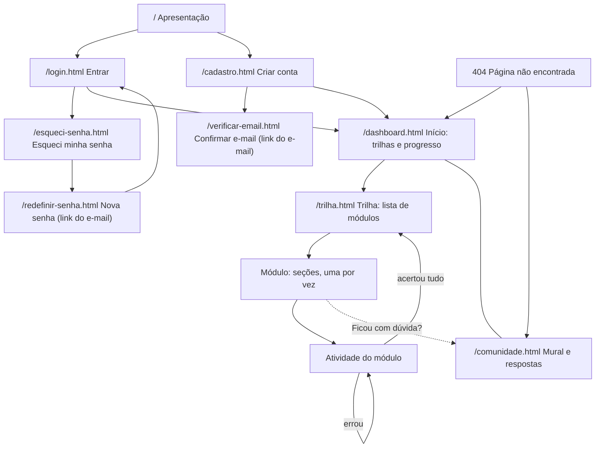
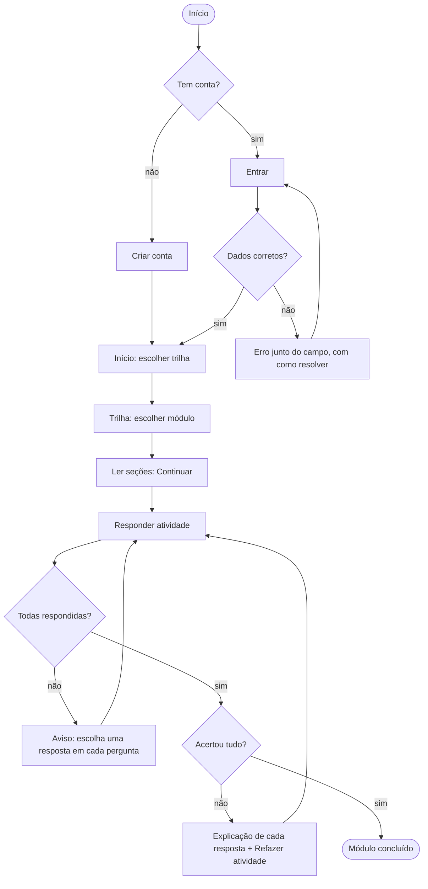

# 3ª AV — Arquitetura da informação

## 1. Mapa do site

Menu principal (barra inferior no celular, lateral no computador): **Início** e **Comunidade**, mais o botão **Sair**. Duas opções só, de propósito: o público tem pouca experiência além do celular e o conteúdo é finito.

## 2. Fluxograma da tarefa principal: concluir um módulo

Todos os becos sem saída foram eliminados: a 404 oferece "Voltar para o início" e "Pedir ajuda na comunidade"; o erro de carregamento oferece "Tentar de novo".

## 3. Rótulos: o que o usuário lê

| Rótulo | Por que está assim |
|---|---|
| Início | Palavra do dia a dia no lugar de "Dashboard" (a página se chama dashboard só no endereço) |
| Comunidade | Nome simples, sem termo técnico |
| Módulos da trilha | "Módulo" é o termo usado em cursos que o público já conhece |
| Começar / Concluído | Estado escrito, não só ícone |
| Pergunte para a turma | Linguagem de convite, não de sistema |

## 4. Card sorting e teste de árvore (precisam de pessoas)

Materiais prontos em `docs/AV3_KIT_TESTES.md` (seções 4 e 5). Abaixo, o espaço para o resultado. **Não preencha com dados inventados**: a 2ª AV foi criticada justamente por falta de teste real.

### Resultado do card sorting
- Participantes: _[preencher]_
- Agrupamentos mais comuns: _[preencher]_
- O que mudou no menu por causa disso: _[preencher]_

### Resultado do teste de árvore
| Tarefa | Acertos / participantes | Caminho mais escolhido | Mudança feita |
|---|---|---|---|
| _[preencher]_ | | | |
